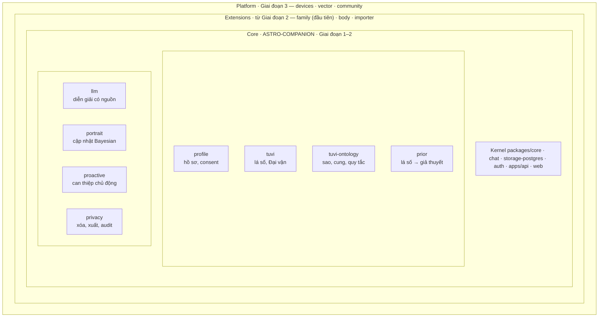
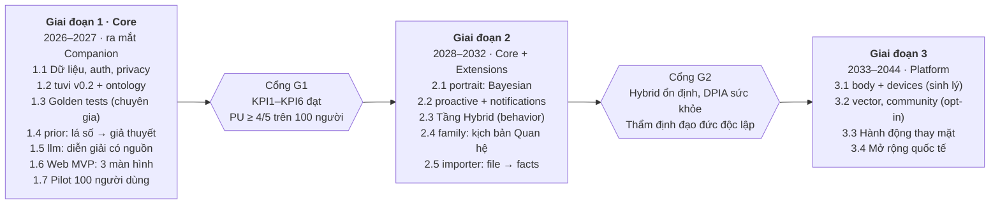

# PROJECT BRIEF v1.1 — ASTRO-COMPANION (Core) & Human Digital Twin (Platform)

| | |
|---|---|
| **Phiên bản** | 1.1 (thay thế [v1.0](archive/project-brief-v1.0.md)) |
| **Ngày** | 2026-10-25 |
| **Tác giả** | @LongNguyen1984 |
| **Trạng thái** | Bản nháp, đang thảo luận |

> Tài liệu tham chiếu chính của dự án. Mọi thay đổi phạm vi, lộ trình hoặc yêu cầu được cập nhật vào file này qua pull request, và ghi lý do trong [`decisions/`](decisions/).

## Thay đổi so với v1.0

Bản v1.1 giữ ASTRO-COMPANION làm **sản phẩm lõi (Core)** và đặt Human Digital Twin thành **nền tảng mở rộng** xây trên lõi đó. Phạm vi Giai đoạn 1 không đổi; các module Twin đã có trong repo được giữ lại nhưng tắt cho đến khi lõi đạt KPI.

- **Định vị:** thêm mô hình ba vòng Core / Extensions / Platform với quy tắc phụ thuộc một chiều (mục 2).
- **Pháp lý:** thay Nghị định 13/2023/NĐ-CP bằng Luật Bảo vệ dữ liệu cá nhân 91/2025/QH15 và Nghị định 356/2025/NĐ-CP, cùng hiệu lực từ 01/01/2026.
- **Yêu cầu:** thêm F9–F12 (tách tử vi khỏi sức khỏe, dữ liệu người thân, tối thiểu hóa dữ liệu gửi LLM, phiên bản quy tắc) và NF6; mỗi yêu cầu gắn trạng thái hiện tại của repo.
- **Kiến trúc:** NF3 đổi từ microservices sang kiến trúc plugin trên một kernel (modular monolith), đúng với code hiện có.
- **Lộ trình:** sắp lại theo từng plugin, có cổng chuyển giai đoạn đo bằng KPI (mục 6).
- **Rủi ro & KPI:** thêm rủi ro phân tán nguồn lực, dữ liệu nhạy cảm, chuyển dữ liệu xuyên biên giới; thêm KPI5–KPI6.

## 1. Vision

**Tầm nhìn:** Kiến tạo một AI Companion **chủ động, thấu hiểu và tôn trọng quyền riêng tư**, là "người bạn đồng hành tri thức" của mỗi cá nhân. Về dài hạn, Companion phát triển thành **Human Digital Twin**: một bản sao số của con người, kết nối lá số Tử vi, các mối quan hệ, sức khỏe và cộng đồng, nhưng chỉ mở rộng khi người dùng cho phép.

**Sứ mệnh:** Kết hợp AI hiện đại (LLM, Agentic AI) với tri thức Tử vi Việt Nam làm **prior** để cá nhân hóa ngay từ ngày đầu mà không cần thu thập nhiều dữ liệu, giải bài toán cold-start của các hệ thống AI thuần dữ liệu.

**Quan hệ Core – Digital Twin:** ASTRO-COMPANION là sản phẩm ra mắt trước và được kiểm chứng trước. Digital Twin là nền tảng và tầm nhìn dài hạn mà Companion lớn lên thành. Hai bên dùng chung một kernel và một luồng dữ liệu (facts pipeline), nên Twin không phải dự án song song mà là các tầng dữ liệu cao hơn của chính Companion.

**Giá trị cốt lõi:**

- **Chủ động (Proactive):** chủ động phát hiện thời điểm và hỗ trợ dựa trên chu kỳ và trạng thái, có giới hạn tần suất.
- **Tối giản dữ liệu (Minimal-Data):** vận hành được với ngày giờ sinh; mỗi bước mở rộng dữ liệu cần sự đồng ý riêng.
- **Minh bạch và kiểm soát được:** mỗi gợi ý nêu rõ căn cứ; người dùng có quyền ghi đè, thu hồi, xóa.
- **Tách biệt tri thức (mới):** Tử vi là khung tham chiếu văn hóa, không bao giờ là căn cứ cho nhận định sức khỏe.
- **Bản địa hóa:** tri thức Tử vi Việt Nam là lợi thế khác biệt so với sản phẩm quốc tế.

## 2. Mô hình ba vòng: Core / Extensions / Platform

Sản phẩm gồm ba vòng đồng tâm trên cùng một kernel. Vòng trong ra mắt trước, và không bao giờ phụ thuộc vòng ngoài.

Core là toàn bộ ASTRO-COMPANION; Extensions và Platform là các module Digital Twin chỉ mở khi qua cổng tương ứng.

**Quy tắc:**

1. **Phụ thuộc một chiều:** plugin vòng ngoài được dùng service và event của Core; plugin Core không khai báo `dependsOn` tới plugin vòng ngoài. CI kiểm tra tự động quy tắc này.
2. **Mỗi vòng là một tầng dữ liệu (F6):** Core ứng với tầng Minimal và Hybrid; Extensions ứng với Full-context (quan hệ, sức khỏe); Platform là dữ liệu chia sẻ với người khác (consent matching).
3. **Consent và đánh giá riêng:** mỗi module ngoài Core có consent scope riêng và được đánh giá tác động trước khi mở.
4. **Mở theo cổng:** Extensions chỉ mở sau Cổng G1; Platform chỉ mở sau Cổng G2 (mục 6).
5. **Tách biệt tử vi – sức khỏe (F9) áp dụng cho mọi vòng:** dữ liệu sức khỏe có thể làm giàu chân dung người dùng, nhưng lá số không bao giờ là căn cứ cho nhận định sức khỏe.

## 3. Requirements

Bốn yêu cầu P0 của lõi (F2, F3, F7, F8) chưa hoàn thành; đây là trọng tâm Giai đoạn 1. Cột "Vòng" cho biết yêu cầu thuộc Core hay module mở rộng (mục 2). Trạng thái repo tính đến 2026-10-25.

### 3.1. Yêu cầu chức năng

| Mã | Yêu cầu | Mô tả | Ưu tiên | Vòng | Trạng thái repo | Ghi chú |
| --- | --- | --- | --- | --- | --- | --- |
| F1 | Thu thập dữ liệu tối thiểu | Ngày, giờ sinh, giới tính → lá số tự động | P0 | Core | Đã có | profile, tuvi, onboarding trong chat |
| F2 | Tử vi Ontology | Cung, sao, can chi, ngũ hành, quy tắc tương tác dưới dạng dữ liệu truy vấn được, có phiên bản theo trường phái | P0 | Core | Một phần | Engine tính được 14 chính tinh, 12 cung, Cục, Đại vận; chưa có ontology, phụ tinh, Tứ Hóa, Tuần/Triệt |
| F3 | Minimal-Data Companion | AI nhận định và gợi ý từ prior cùng vài câu hỏi làm quen | P0 | Core | Chưa có | Mới có điểm mở rộng tuvi.interpreter |
| F4 | Cập nhật Bayesian | Phản hồi và hành vi điều chỉnh "chân dung"; xác nhận/từ chối fact là tín hiệu likelihood | P1 | Core | Chưa có | Facts pipeline là nguồn tín hiệu sẵn có |
| F5 | Chủ động can thiệp | Dựa trên Đại vận, Lưu niên và hành vi để hỏi thăm, nhắc, gợi ý; có giới hạn tần suất | P1 | Core | Chưa có | Cần Lưu niên và bộ lập lịch |
| F6 | Phân tầng dữ liệu | Minimal → Hybrid → Full-context; mỗi tầng là một gói consent scope | P1 | Core | Một phần | Có scope health, family, matching; thiếu scope behavior và thiết lập tầng |
| F7 | Giải thích | Mỗi gợi ý trích dẫn cung, sao, vận hạn và ruleVersion làm căn cứ | P0 | Core | Chưa có | Đưa vào hợp đồng của tuvi.interpreter |
| F8 | Quản lý quyền riêng tư | Xem, sửa, xóa, xuất dữ liệu; audit log mọi lần AI chủ động can thiệp | P0 | Core | Một phần | Có consent và xác nhận fact; thiếu xóa, xuất, audit log |
| F9 (mới) | Tách biệt tử vi – sức khỏe | Tử vi không làm căn cứ cho nhận định sức khỏe; tuvi không ghi dữ liệu body | P0 | Core + Extensions | Một phần | Đã là quy tắc kiến trúc; cần test và guardrail ngôn ngữ |
| F10 (mới) | Dữ liệu người thân | Người thân "bóng" chỉ được lưu khi có consent family; người thân có quyền yêu cầu xóa | P1 | Extensions | Một phần | Plugin family đã có |
| F11 (mới) | Tối thiểu hóa dữ liệu gửi LLM | Chỉ gửi lá số và ngữ cảnh cần thiết, đã ẩn danh hóa; không gửi dữ liệu sức khỏe | P0 | Core | Chưa có | Điều kiện cho việc dùng API LLM nước ngoài |
| F12 (mới) | Phiên bản quy tắc và golden tests | Mọi lá số lưu ruleVersion; bộ lá số tham chiếu do chuyên gia kiểm định | P0 | Core | Một phần | Có ruleVersion; chưa có golden tests |

### 3.2. Yêu cầu phi chức năng

| Mã | Yêu cầu | Mô tả | Trạng thái repo | Ghi chú |
| --- | --- | --- | --- | --- |
| NF1 | Bảo mật và quyền riêng tư | Mã hóa khi lưu trữ và truyền tải; tuân thủ Luật 91/2025/QH15 và Nghị định 356/2025/NĐ-CP, tham chiếu GDPR; hồ sơ chuyển dữ liệu xuyên biên giới khi dùng API LLM nước ngoài | Chưa có | Dữ liệu đang lưu trong bộ nhớ |
| NF2 | Hiệu năng | Phản hồi < 2 giây cho tác vụ thông thường; LLM trả lời dạng stream, cache diễn giải theo lá số | Một phần | Phần tính toán tất định đã nhanh |
| NF3 | Khả năng mở rộng | Kiến trúc plugin trên một kernel; tách plugin thành dịch vụ riêng khi tải đòi hỏi | Đã có | packages/core |
| NF4 | Ngôn ngữ xác suất | Không khẳng định tuyệt đối ("bạn sẽ…"); guardrail và test tự động chặn câu khẳng định | Chưa có | Thuộc plugin llm |
| NF5 | Khả năng tiếp cận | Tiếng Việt là ngôn ngữ chính, giao diện thân thiện | Đã có | |
| NF6 (mới) | Kiểm chứng được | Test đặt cạnh code; mỗi luồng dữ liệu có test end-to-end | Đã có | 37 test hiện có |

## 4. Key components

Mỗi thành phần trong kiến trúc "3 lớp + 1 lõi" của v1.0 tương ứng với một plugin trên kernel `packages/core`. Plugin giao tiếp qua service, event, extension point và fact; không plugin nào import phần bên trong của plugin khác. Tám plugin mới cần xây cho Core.

| Lớp | Thành phần | Plugin | Vòng | Hiện trạng |
| --- | --- | --- | --- | --- |
| Lõi Tri thức | Tử vi Ontology Engine | `tuvi-ontology` | Core | Mới |
| Lõi Tri thức | Astro-Calculation Module | `tuvi` | Core | Có (v0.1) |
| Lõi Tri thức | Prior Generator | `prior` | Core | Mới |
| Lõi AI | LLM Integration Layer | `llm` | Core | Mới |
| Lõi AI | Explanation Module | hợp đồng `tuvi.interpreter` (bắt buộc trả nguồn) | Core | Có điểm mở rộng |
| Lõi AI | Bayesian Update Engine | `portrait` | Core | Mới |
| Lõi AI | Proactive Decision Engine (khung 6A) | `proactive` | Core | Mới |
| Tương tác | Conversational UI | `chat` + `web` | Core | Có `chat`; `web` mới |
| Tương tác | Proactive Notification System | `notifications` | Core | Mới |
| Tương tác | Privacy Dashboard | `privacy` + `web` | Core | Mới (có API consent) |
| Dữ liệu & Hạ tầng | Secure Data Vault | `storage-postgres` (mã hóa) | Core | Mới |
| Dữ liệu & Hạ tầng | Audit Log System | `privacy` | Core | Mới |
| Dữ liệu & Hạ tầng | Xác thực và phân quyền | `auth` | Core | Mới |
| Dữ liệu & Hạ tầng | API Gateway | `apps/api` | Core | Có |
| Dữ liệu & Hạ tầng | Kernel: plugin, event, consent, facts | `packages/core` | Core | Có |
| Twin | Gia đình và quan hệ | `family` | Extensions | Có (tắt) |
| Twin | Cơ thể và sức khỏe | `body` | Extensions | Có (tắt) |
| Twin | Nhập dữ liệu từ file | `importer` | Extensions | Mới |
| Twin | Thiết bị đeo | `devices` | Platform | Mới |
| Twin | Ghép nối theo độ tương đồng | `vector` | Platform | Mới |
| Twin | Cộng đồng | `community` | Platform | Mới |

**Hai bản phân phối từ một repo:** `plugins.config.ts` định nghĩa bản *companion* (chỉ plugin Core) và bản *twin* (Core cùng các plugin Extensions/Platform đã mở). Plugin đã có như `body`, `family` được giữ và chạy test, nhưng không nạp trong bản companion.

## 5. Scope

Giai đoạn 1 (2026–2027) chỉ giao Core: nhập ngày giờ sinh, nhận lá số, trò chuyện với Companion ở chế độ Minimal-Data, có giải thích và quản lý quyền riêng tư.

### 5.1. Trong phạm vi Giai đoạn 1

- **Số hóa tri thức:** Tử vi Ontology theo 1–2 trường phái chuẩn, có phiên bản; `tuvi` v0.2 với phụ tinh, Tứ Hóa, Tuần/Triệt, Tràng Sinh, Lưu niên; bộ golden tests do chuyên gia kiểm định.
- **Nguyên mẫu:** web app (mobile sau) với 3 màn hình: nhập ngày giờ sinh, xem lá số, chat; cùng trang quản lý quyền riêng tư.
- **AI Companion:** nhận định ban đầu về tính cách, xu hướng và 1–2 gợi ý hành động từ prior, mỗi gợi ý kèm giải thích.
- **Nền tảng:** lưu trữ mã hóa, xác thực, xóa và xuất dữ liệu, audit log.
- **Khung đạo đức và pháp lý:** bộ nguyên tắc đạo đức; khung ngôn ngữ xác suất; đánh giá theo Luật 91/2025/QH15 và Nghị định 356/2025/NĐ-CP, gồm chuyển dữ liệu xuyên biên giới khi dùng API LLM.
- **Kiểm chứng giả thuyết:** đo cảm nhận "được hiểu" so với chatbot thông thường trên 100 người dùng.

### 5.2. Ngoài phạm vi Giai đoạn 1

- Phát triển thêm các module Twin đã có (`body`, `family`): giữ trong repo, tắt trong bản companion, chỉ sửa lỗi.
- Dữ liệu sinh trắc học và thiết bị đeo (`devices`).
- Ghép nối người dùng theo lá số và phòng cộng đồng (`vector`, `community`).
- Hành động thay mặt người dùng (proxy).
- Thị trường quốc tế (chỉ Việt Nam và cộng đồng người Việt hải ngoại).
- Mô hình LLM riêng (dùng API bên thứ ba).

## 6. Realigned roadmap

Giai đoạn 1 chỉ xây Core trong 7 bước; Extensions mở sau Cổng G1 và Platform sau Cổng G2. Giai đoạn 0 (kernel, profile, tuvi v0.1, body, family, chat, api, 37 test) đã xong.

Cổng G1 là đủ sáu KPI ở mục 8. Cổng G2 gồm tầng Hybrid hoạt động ổn định, đánh giá tác động cho dữ liệu sức khỏe, và thẩm định đạo đức độc lập cho việc ghép nối.

### Chi tiết từng bước

| Bước | Plugin | Nội dung | Phụ thuộc | Vòng |
| --- | --- | --- | --- | --- |
| 1.1 | `storage-postgres`, `auth`, `privacy` | Lưu trữ thật có mã hóa và migration; đăng nhập, quyền chủ sở hữu/người thân; xóa, xuất, audit log | core, profile | Core |
| 1.2 | `tuvi` v0.2, `tuvi-ontology` | Phụ tinh, Tứ Hóa, Tuần/Triệt, Tràng Sinh, Lưu niên; ontology có phiên bản theo trường phái | profile | Core |
| 1.3 | bộ test | Golden tests trên bộ lá số tham chiếu do chuyên gia kiểm định | tuvi | Core |
| 1.4 | `prior` | Chuyển lá số thành giả thuyết có trọng số về tính cách, xu hướng, thời điểm nhạy cảm | tuvi, tuvi-ontology | Core |
| 1.5 | `llm` | Hiện thực tuvi.interpreter: giải thích bắt buộc, guardrail ngôn ngữ, tối thiểu hóa dữ liệu gửi đi | chat, prior | Core |
| 1.6 | `web` | Nhập ngày giờ sinh, xem lá số, chat, trang quyền riêng tư | apps/api | Core |
| 1.7 | pilot | 100 người dùng thử; đo KPI1–KPI6 | 1.1–1.6 | Core |
| 2.1 | `portrait` | Chân dung posterior từ prior, phản hồi và hành vi; người dùng xem và ghi đè được | prior, chat | Core |
| 2.2 | `proactive`, `notifications` | Chọn thời điểm theo Đại vận, Lưu niên và hành vi; giới hạn tần suất; ghi audit | portrait, privacy | Core |
| 2.3 | consent | Scope behavior; thiết lập tầng Minimal / Hybrid / Full-context | profile | Core |
| 2.4 | `family` | Kịch bản Quan hệ: tương hợp lá số giữa người thân, consent family | tuvi, portrait | Extensions |
| 2.5 | `importer` | CSV / Excel / JSON → facts, cùng luồng xác nhận | profile | Extensions |
| 3.1 | `body`, `devices` | Quan sát sức khỏe; Apple Health, Health Connect | body, privacy | Extensions + Platform |
| 3.2 | `vector`, `community` | Ghép nối opt-in; phòng có kiểm duyệt, không tự trích xuất dữ liệu sức khỏe | chat, portrait | Platform |

## 7. Rủi ro và biện pháp giảm thiểu

Hai rủi ro cao nhất là pháp lý (định vị tử vi và dữ liệu nhạy cảm) và phân tán nguồn lực giữa Core và Twin; cả hai được xử lý bằng cổng chuyển giai đoạn.

| Rủi ro | Mức độ | Biện pháp giảm thiểu |
| --- | --- | --- |
| **Pháp lý:** bị coi là "dự đoán không có căn cứ khoa học" | Cao | Định vị là khung tham chiếu văn hóa; ngôn ngữ xác suất có guardrail; tham vấn luật sư. |
| **Phân tán nguồn lực (mới):** đội nhỏ chia sức cho các module Twin trước khi lõi được kiểm chứng | Cao | Phụ thuộc một chiều; module Twin tắt trong bản companion; chỉ mở Extensions sau Cổng G1. |
| **Dữ liệu nhạy cảm (mới):** dữ liệu sức khỏe và sinh trắc học chịu yêu cầu bảo vệ cao hơn | Cao | Để ngoài Core; consent riêng; đánh giá tác động trước khi mở (Cổng G2). |
| **Chuyển dữ liệu xuyên biên giới (mới):** API LLM đặt ở nước ngoài | Cao | Tối thiểu hóa và ẩn danh hóa dữ liệu gửi đi (F11); hồ sơ chuyển dữ liệu; cân nhắc nhà cung cấp có lưu trữ trong khu vực. |
| **Cạnh tranh:** các công ty lớn ra sản phẩm tương tự | Cao | Lợi thế ở tri thức Tử vi Việt Nam và kiến trúc minimal-data. |
| **Đạo đức:** AI áp đặt bản sắc cố định lên người dùng | Trung bình | Prior có thể ghi đè; người dùng luôn được phủ định gợi ý; posterior hiển thị được. |
| **Kỹ thuật:** mâu thuẫn giữa các trường phái Tử vi | Trung bình | Chọn 1–2 trường phái chuẩn; tham số hóa quy ước (giờ Tý, tháng nhuận); ruleVersion; golden tests. |
| **Thị trường:** người dùng e ngại yếu tố tâm linh | Trung bình | Định vị là công cụ tự khám phá bản thân, không phải bói toán. |
| **Người thân không đồng ý (mới):** dữ liệu về người thân do người dùng nhập | Trung bình | Chỉ lưu khi có consent family; người thân được quyền yêu cầu xóa (F10). |
| **Phân biệt đối xử theo lá số (mới):** ghép nối người dùng dựa trên lá số | Trung bình | Chỉ ở vòng Platform, opt-in, có kiểm duyệt; đánh giá đạo đức trước khi mở. |

## 8. KPIs Giai đoạn 1

Đạt đủ sáu KPI dưới đây là điều kiện mở Cổng G1 sang Giai đoạn 2.

| KPI | Chỉ số | Mục tiêu | Cách đo |
| --- | --- | --- | --- |
| KPI1 | Độ phủ Tử vi Ontology | ≥ 80% khái niệm cốt lõi | Danh mục khái niệm do chuyên gia lập, so với ontology |
| KPI2 | Cảm nhận "được hiểu" (Perceived Understanding) | ≥ 4/5 trên 100 người dùng thử | Khảo sát sau pilot, so với chatbot thông thường |
| KPI3 | Gợi ý có giải thích | 100% | Kiểm tra tự động trên hợp đồng tuvi.interpreter |
| KPI4 | Khung đạo đức và pháp lý | Được ít nhất 1 chuyên gia độc lập thông qua | Biên bản thẩm định, theo Luật 91/2025/QH15 |
| KPI5 (mới) | Độ chính xác lá số | 100% golden tests đạt | Bộ lá số tham chiếu do chuyên gia kiểm định |
| KPI6 (mới) | Ngôn ngữ xác suất | 0 câu khẳng định tuyệt đối | Bộ đánh giá guardrail trên tập câu trả lời mẫu |

## 9. Đội ngũ, nguồn lực và quyết định mở

**Nhân sự chủ chốt (Giai đoạn 1):** 1 Project Lead / Product Owner; 1 chuyên gia Tử vi / Văn hóa học (ontology và golden tests); 1–2 kỹ sư AI/ML (LLM, Bayesian); 1 kỹ sư Backend / Data; 1 chuyên gia Đạo đức AI / Pháp lý (kiêm đầu mối bảo vệ dữ liệu); 1 UI/UX Designer. Module Twin chưa cần nhân sự riêng trong Giai đoạn 1.

**Nguồn lực công nghệ:** TypeScript / Node (Fastify) trên kernel plugin hiện có; PostgreSQL (pgvector khi tới vòng Platform); API LLM bên thứ ba; hạ tầng cloud, ưu tiên vùng gần Việt Nam.

**Quyết định cần chốt:**

- [x] Tên thương mại: giữ ASTRO-COMPANION cho Core và Human Digital Twin cho nền tảng?
- [x] Trường phái Tử vi làm chuẩn cho ontology và golden tests.
- [ ] `family` có phải module Extensions đầu tiên (kịch bản Quan hệ) không.
- [x] Nhà cung cấp LLM và vị trí lưu trữ dữ liệu.
- [x] Dự án có thuộc diện doanh nghiệp nhỏ / khởi nghiệp được hoãn đánh giá tác động và nhân sự bảo vệ dữ liệu trong 5 năm không (cần luật sư xác nhận).

> Các quyết định đã chốt cần ghi lại kết quả và lý do trong [`decisions/`](decisions/).

**Nguồn pháp lý:**

- [EY: Nghị định 356/2025/NĐ-CP hướng dẫn Luật Bảo vệ dữ liệu cá nhân (03/2026)](https://www.ey.com/vi_vn/technical/tax/tax-and-law-updates/nghi-dinh-so-356-2025-nd-cp-quy-dinh-chi-tiet-mot-so-dieu-va-bien-phap-thi-hanh-luat-bao-ve-du-lieu-ca-nhan)
- [KPMG: Quốc hội thông qua Luật Bảo vệ dữ liệu cá nhân (06/2025)](https://kpmg.com/vn/vi/home/phan-tich-chuyen-sau/2025/06/vietnam-new-personal-data-protection-law.html)
- [LuatVietnam: Nghị định 356/2025/NĐ-CP](https://luatvietnam.vn/dan-su/nghi-dinh-356-2025-nd-cp-quy-dinh-chi-tiet-luat-bao-ve-du-lieu-ca-nhan-422896-d1.html)
- [Forvis Mazars: Luật số 91/2025/QH15](https://www.forvismazars.com/vn/vi/n-ph-m-s-ki-n/c-p-nh-t-v-vi-t-nam/goc-nhin-chuyen-mon/tuan-th-lu-t-b-o-v-d-li-u-ca-nhan)
